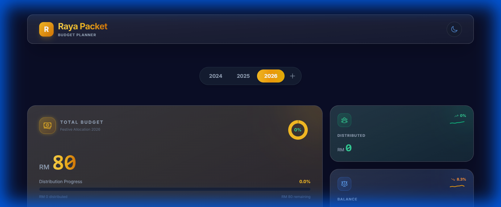

# Raya Packet Budget Planner 🌙✨

> **A modern, full-stack digital budget planner for festive money packets (Duit Raya).**  
> Built with React 18, Vite 5, Node.js Express, PostgreSQL, and Prisma with a focus on festive UI/UX, family categorization, cash note calculation, and printable bank withdrawal slips.

<p align="center">
  
</p>

---

## ⚡ Key Highlights

| Feature | Description |
| :--- | :--- |
| 📊 **Real-time Overview** | Real-time budget tracking: Total Budget, Distributed Amounts, Remaining Balance, and Progress Rings. |
| 📅 **Multi-Year History** | Seamlessly switch between festive years (e.g. 2024, 2025, 2026) to track past spending and future plans. |
| 🏷️ **7 Recipient Categories** | Organize into *Family*, *Single*, *In-laws*, *Relatives*, *Neighbors*, *Colleagues/Friends*, and *Charity* with quick-filter chips and live search. |
| 💵 **Banknote Breakdown** | Calculates required notes across RM1, RM5, RM10, RM20, RM50, and RM100 denominations. |
| 🖨️ **Printable Bank Slip** | Ready-to-print cash withdrawal slip modal formatted for bank tellers with signature blocks and `@media print` styling. |
| 🛡️ **Hardened Security** | Bcrypt DoS guard (8–72 chars), live DB admin verification, tiered rate limiting, and production error masking. |
| 🚀 **Single-Process Dev** | Express dynamically embeds Vite in middleware mode. One command, one port (`5172`), and instant $<50\text{ms}$ live HMR without building. |

---

## 🛠 Tech Stack

- **Frontend**: React 18, Vite 5, Tailwind CSS, Framer Motion, Recharts, Heroicons
- **Backend**: Node.js, Express.js, Prisma ORM, Helmet, Compression, Express Rate Limit, BcryptJS, JWT
- **Database**: PostgreSQL 18+ (Prisma schema migrations)
- **Local Dev Stack**: EnvKit (Reverse-proxy on `https://do-itraya.test` with automatic SSL)

---

## 📋 Commands Cheat Sheet

| Command | Purpose |
| :--- | :--- |
| `npm run dev` | Starts the unified server with Vite HMR in development mode |
| `npm run build` | Compiles optimized static production assets into `client/dist` |
| `npm start` | Runs the high-performance production server serving `client/dist` |
| `npm run reset-password <email> <newPassword>` | CLI utility to reset any user's password directly from the server |

---

## 🚀 Quick Start Guide

### Prerequisites
- **Node.js** (v18 or higher)
- **PostgreSQL** running locally (e.g. via EnvKit or standalone on port `5432`)

### 1. Install Dependencies
```bash
# Install root, client, and server dependencies
npm install
cd client && npm install
cd ../server && npm install
cd ..
```

### 2. Configure Environment Variables
Ensure `server/.env` contains your database and server credentials:

```env
PORT=5172
NODE_ENV=development
JWT_SECRET=your_secure_random_jwt_secret
CLIENT_URL=https://do-itraya.test

# Database Configuration
DB_USER=postgres
DB_PASSWORD=your_password
DB_HOST=localhost
DB_PORT=5432
DB_NAME=do_itraya
DB_SCHEMA=public

DATABASE_URL="postgresql://${DB_USER}:${DB_PASSWORD}@${DB_HOST}:${DB_PORT}/${DB_NAME}?schema=${DB_SCHEMA}"
```

### 3. Initialize Database
Apply Prisma migrations to your PostgreSQL database:

```bash
cd server
npx prisma migrate deploy
cd ..
```

### 4. Run the Application
Start the unified application with a single command:

```bash
npm run dev
```

> [!TIP]
> **Using EnvKit?**  
> Open the **EnvKit** desktop app and click the **Start** button on the `do-itraya` card. The app is immediately available at **`https://do-itraya.test`** with zero port conflicts.

---

## 🛡️ Security & Hardening Features

This application implements multi-layered security controls:

1. **Input Validation**: Zero-dependency schema validator ([validate.js](server/middleware/validate.js)) rejects non-whitelisted denominations, negative values, and passwords outside 8–72 characters (preventing bcrypt CPU exhaustion DoS).
2. **Stale Admin Mitigation**: [adminMiddleware.js](server/middleware/adminMiddleware.js) queries live PostgreSQL `is_admin` status on every administrative request, preventing demoted admins from acting on stale JWT claims.
3. **Tiered Rate Limiting**: [rateLimiter.js](server/middleware/rateLimiter.js) restricts `/api/auth` (10 attempts/15min) and general `/api` (300 requests/15min) using Express `req.ip` behind trusted proxies.
4. **Data Leakage Prevention**: [errorHandler.js](server/middleware/errorHandler.js) masks internal database traces, query strings, and stack traces when running in `production` mode.
5. **PostgreSQL Type Safety**: Strict integer coercion on all database write operations preventing Prisma type-mismatch crashes.

---

## 🛠️ Server Maintenance & Administration

### Reset User Password (Host CLI)
If an account password is forgotten or an administrator is locked out, run the maintenance utility directly from the server terminal:

```bash
npm run reset-password <email> <newPassword>
```

**Example:**
```bash
npm run reset-password hakim_s09@hotmail.com MyNewSecurePass123
```

> [!NOTE]
> This command requires direct shell/SSH access to the host machine and cannot be triggered externally via HTTP.

### Run Backend Unit Tests
Execute the test suites verifying validation, error handling, rate limiting, and admin checks:

```bash
node server/tests/validation.test.js
node server/tests/errorHandler.test.js
node server/tests/adminMiddleware.test.js
node server/tests/rateLimiter.test.js
```

---

## 🌍 Production Deployment

### 1. Build Client Assets
```bash
npm run build
```

### 2. Start the Production Server
```bash
npm start
```
In production (`NODE_ENV=production`), Express automatically serves pre-built, cached static assets from `client/dist` and handles API requests under a single port.

---

## 📂 Project Structure

```text
do-itraya/
├── client/                     # React Frontend Application
│   ├── src/
│   │   ├── components/         # UI Components (BankSlipModal, ReceiverList, etc.)
│   │   ├── pages/              # Route Pages (HomePage, LoginPage, etc.)
│   │   └── context/            # Global State (AuthContext, ThemeContext)
│   ├── dist/                   # Production build output (generated)
│   ├── vite.config.js          # Vite configuration
│   └── tailwind.config.js      # Festive color palette & styling
├── server/                     # Node.js Express Backend
│   ├── middleware/             # Security middlewares (validate, rateLimiter, etc.)
│   ├── prisma/                 # Database schema & migrations
│   ├── scripts/                # Administrative tools (resetPassword.js)
│   ├── tests/                  # Unit test suites
│   ├── index.js                # Unified server & Vite middleware entry
│   └── .env                    # Environment credentials (ignored by git)
├── docs/                       # Project documentation & preview images
├── package.json                # Root workspace scripts & orchestrator
└── README.md                   # Project documentation
```
